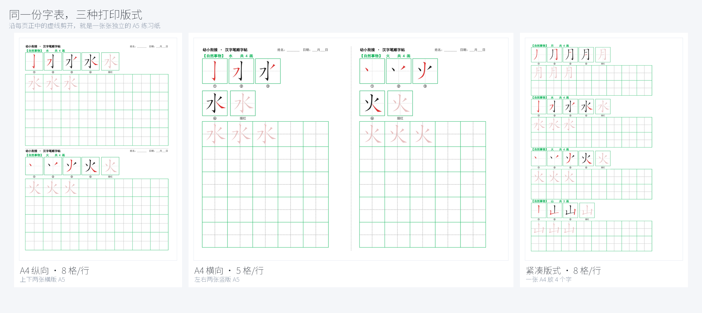
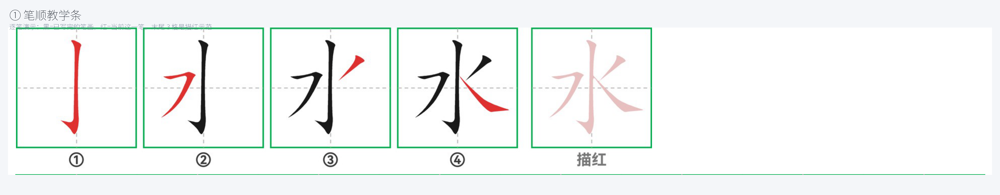
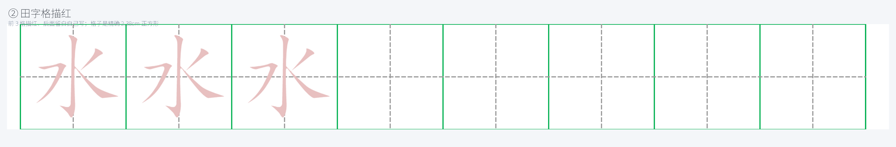
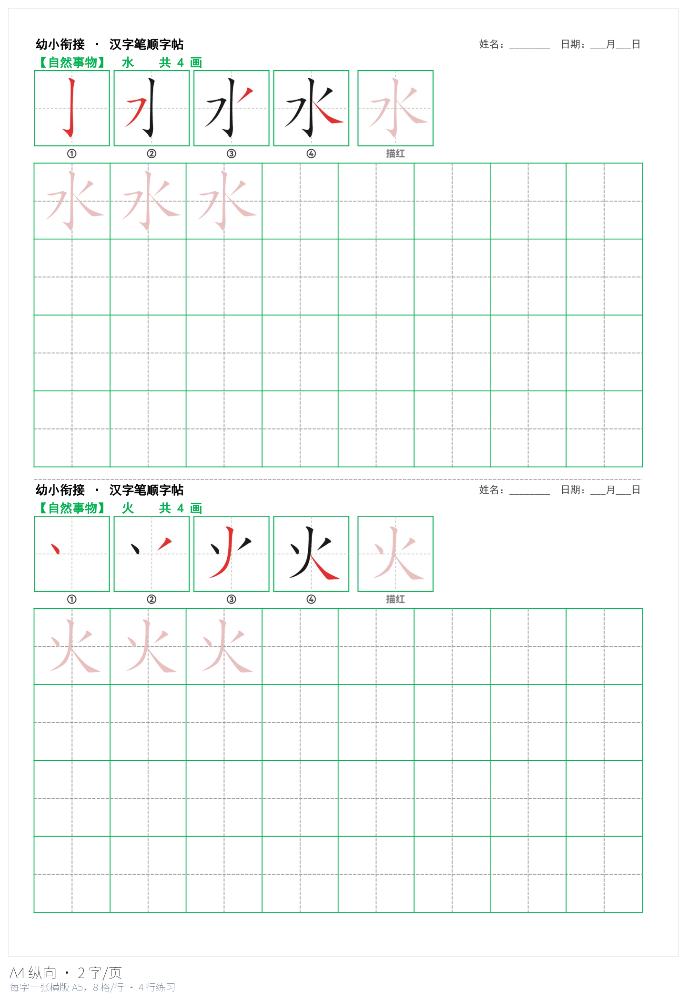
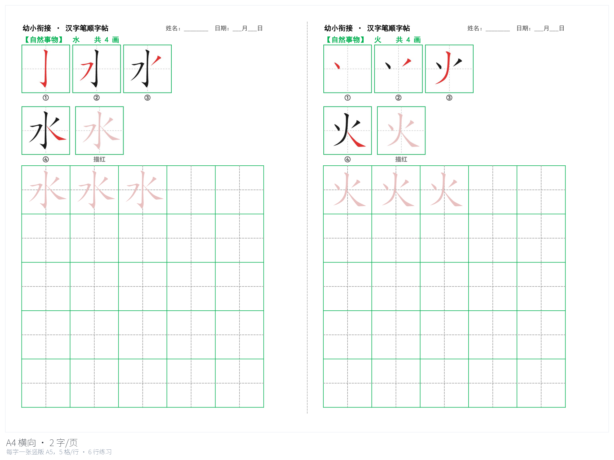
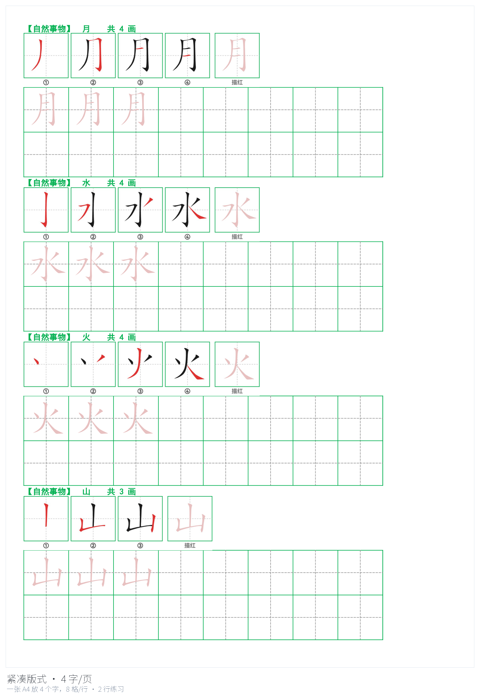
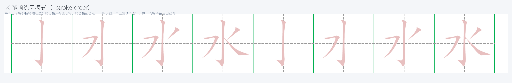
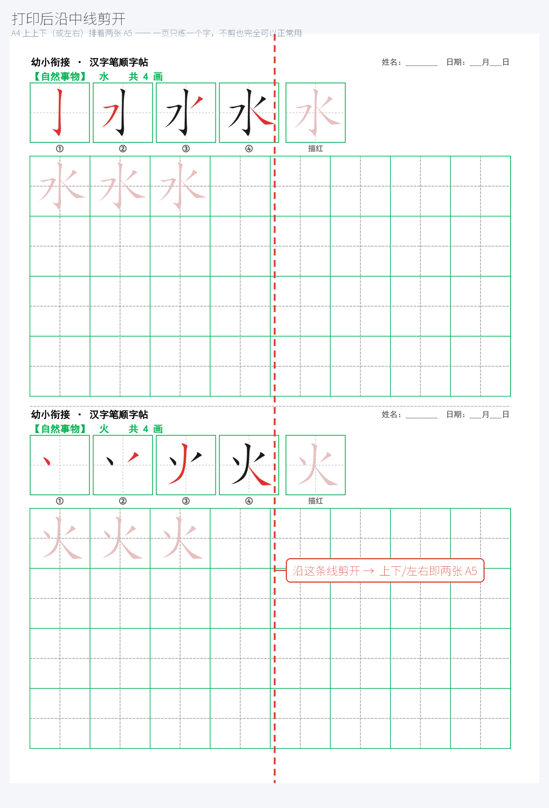
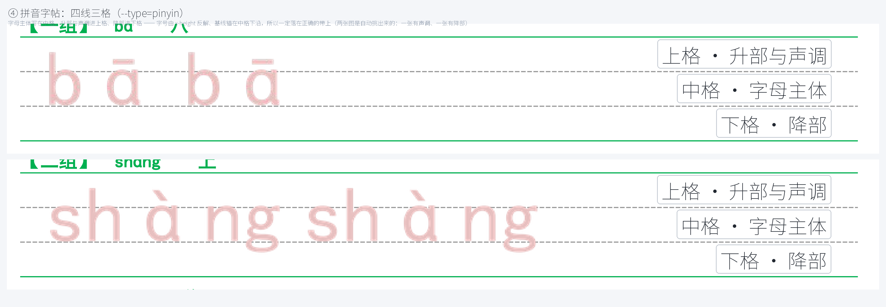

<div align="center">

# 汉字笔顺字帖生成器

**给一串汉字，生成可直接打印的笔顺描红字帖**

Excel + PDF 双格式 · 几何精确到 0.1mm · 完全离线

<sub>一张 A4 只练 2 个字，沿中线剪开就是两张 A5 —— 一页一个字，练习量刚刚好</sub>




</div>

---

## 目录

[为什么写这个工具](#为什么写这个工具) ·
[它长什么样](#它长什么样) ·
[三种打印版式](#三种打印版式) ·
[两种练习方式](#两种练习方式) ·
[快速开始](#快速开始) ·
[打印与裁剪](#打印与裁剪) ·
[拼音字帖](#拼音字帖) ·
[命令行参数](#命令行参数) ·
[技术要点](#技术要点) ·
[自带验收脚本](#自带验收脚本) ·
[已知限制](#覆盖范围与已知限制) ·
[常见问题](#常见问题) ·
[English](#english)

---

## 为什么写这个工具

学龄前和一年级的孩子要练字，但买来的字帖总有那么几个别扭的地方：

| 市面上的字帖 | 这个工具 |
| --- | --- |
| 想练的字书上没有，只能整本买 | **任意字表**：从课本生字表复制粘贴就行，也可以自己排顺序分组 |
| 一页密密麻麻十几个字，孩子写两笔就跑 | **一页只练 2 个字**（默认版式），一页写满正好是一次练习量 |
| 笔顺图分不清哪一笔是新的 | **逐笔教学条**：黑 = 已写完、红 = 当前这一笔，末尾 3 格描红示范 |
| 打印出来格子不是正方形，裁剪线还是歪的 | **几何精确**：田字格 2.38125cm 正方形，裁切线误差 0.1mm（有验收脚本作证） |
| 要联网、要注册、要充值 | **完全离线**：9575 字的字库打包在仓库里，克隆下来就能用 |

---

## 它长什么样

### ① 笔顺教学条



按笔顺逐笔演示（① ② ③ ④…）：**黑色的笔画表示「已经写完了」，红色的是「当前这一笔」**，
孩子顺着看一遍就知道这个字先写哪一笔。末尾 3 格是描红示范，可以直接描。

笔画多的字（7 画以上）自动折成两行，不会挤成一团；18 画的字会占三行。

### ② 田字格描红



每行 8 格：**前 3 格描红**（浅红的字，直接描），**后面 5 格留白**自己写。
格子是 2.38125cm 的精确正方形，内部带田字格标准十字虚线。

---

## 三种打印版式

同一份字表，三种排法。用 `--layout` 和 `--orient` 切换：

| 命令 | 一张 A4 | 每张 A5 | 每行 | 34 个字 → |
| --- | --- | --- | --- | --- |
| `--layout=a5`（默认） | 2 个字，上下排 | 21 × 14.85cm 横版 | 8 格 | 17 页 |
| `--layout=a5 --orient=landscape` | 2 个字，左右排 | 14.85 × 21cm 竖版 | 5 格 | 17 页 |
| `--layout=a4` | 4 个字（紧凑省纸） | — | 8 格 | 9 页 |

<p align="center">
  
  
</p>

**左：A4 纵向**（默认）—— 上下两张横版 A5，每行 8 格，每字 4 行练习。
**右：A4 横向** —— 左右两张竖版 A5，每行 5 格（半页只有 14.85cm 宽，放不下 8 个 2.4cm
的格子，所以自动改成 5 格，格子大小不变）。

<p align="center">
  
</p>

**紧凑版式** `--layout=a4` —— 一张 A4 放 4 个字，格子 2.01cm、每字 2 行，适合需要省纸的时候。

---

## 两种练习方式

田字格里放什么，由 `--stroke-order` 决定。

**默认（不加参数）—— 描红 + 自己写。** 每个字的第一行前 3 格是整字描红，其余留白：


**笔顺练习模式（`--stroke-order`）—— 每一格都练笔顺。**
第 1 格只有第 1 笔，第 2 格前 2 笔……第 N 格才是完整的字。这样练 3 遍，
再重复 3 个整字，剩下的格子留白自己写：



上图是「水」的第一行 8 格：左边 4 格是第 1 遍的逐笔递进，右边 4 格是第 2 遍，
墨迹一格格变多，孩子照着顺序描就行。

```bash
python3 zitie_gen.py 水火日月 --stroke-order                    # A4 纵向，每字 32 格
python3 zitie_gen.py 水火日月 --stroke-order --orient=landscape # A4 横向，每字 10 格
```

### 格子不够时怎么降级

每个字能分到多少田字格，是由笔画数（教学条占几行）决定的，所以排布会自动调整：

| 字 | 每字格子 | 实际排布 |
| --- | --- | --- |
| 水、火（4 画） | 32 格 | 笔顺 3 遍 + 整字 3 个 + 留白 17 格 |
| 间（7 画） | 16 格 | 笔顺 2 遍 + 整字 2 个 + 留白 0 |
| 影（15 画） | 8 格 | 笔顺压缩成 1 遍（每格递进 1~3 笔）+ 整字 1 个 |

降级顺序是固定的：**先减整字的个数，再减笔顺的遍数**，优先保证笔顺练到。
笔画比格子还多时（≥14 画的字只有 8 格），把一遍笔顺均匀压缩进格子 ——
第 1 格给第 1 笔、最后一格给全部笔画，顺序一笔不漏。

生成时会把每个字的实际排布打印出来，不用自己算：

```text
水　 4 画 / 32 格 -> 笔顺 3 遍 + 整字 3 + 留白 17
影　15 画 /  8 格 -> 笔顺压缩 1 遍（7 格） + 整字 1 + 留白 0
```

---

## 快速开始

```bash
git clone <你的仓库地址>
cd <仓库名>

pip install -r requirements.txt

# 生成字帖：给一串字就行
python3 zitie_gen.py 天地花鸟虫
```

输出在 `output/字帖_天地花鸟虫/`：

| 文件 | 用途 |
| --- | --- |
| `字帖_天地花鸟虫.pdf` | **打印用这份**，几何已经逐列校准过 |
| `字帖_天地花鸟虫.xlsx` | 可编辑、可改字，也能在 WPS / Excel 里直接打印 |

> 第一次运行会自动把 `data/` 里的字库压缩包（13MB）解开成
> `data/hanzi-writer-data/`（约 47MB，9575 个 json），之后完全离线。
> 想保持目录精简可以删掉它，下次运行会重新解开。

### 更多用法

```bash
# 从文本文件读字表（支持「组名: 字表」分组，见 字表示例.txt）
python3 zitie_gen.py --file=字表示例.txt --name=我的字帖

# 自定义标题
python3 zitie_gen.py 天地人 --title="一年级生字练习"

# A4 横向：左右两张竖版 A5
python3 zitie_gen.py 天地花鸟虫 --orient=landscape

# 只要 xlsx，不导 PDF
python3 zitie_gen.py 天地人 --no-pdf

# 格子再大一点
python3 zitie_gen.py 天地人 --cell-cm=2.6

# 看全部参数
python3 zitie_gen.py --help
```

---

## 打印与裁剪

打印时选**实际大小 / 100%**，不要用「适应页面」—— 那样整页会被缩放，
格子就不是 2.38cm 的正方形了（`verify_pdf.py` 专门检查这一点）。
纸型 A4，页边距不用调，打印区域在生成时已经设好。

每页正中有一条裁切线，沿线剪开就是两张 A5 —— 一张一个字，正好是一次练习量。
**方向随版式变，别弄反**：

| 版式 | 两张 A5 怎么排 | 裁切线 | 怎么剪 |
| --- | --- | --- | --- |
| `--orient=portrait`（默认） | 上下排 | **横线** | 横着剪一刀 |
| `--orient=landscape` | 左右排 | **竖线** | 竖着剪一刀 |



---

## 拼音字帖

同一个工具还能生成**拼音字帖**（`--type=pinyin`）：一行一个音节，A4 纵向，四线三格。
字母主体写在中格、升部与声调进上格、降部进下格。



| 特点 | 说明 |
| --- | --- |
| **字母真的坐在带上** | 字号由 x-height 反解、基线锚在中格下沿 —— 不是「放进格子居中」，那会让字母整条带地偏 |
| **四线三格是原生表格** | 上下两条绿实线 + 中间两条灰虚线，全是 Excel 边框，不合并单元格，打印很锐利 |
| **不查词典，因此不会错** | 音节由你直接给出，多音字（行 `xíng/háng`）不会被替你瞎猜 |
| **两种写法都收** | `bā`（带调字符）与 `ba1`（数字标调）等价；`nv3` 也能写 |
| **字体自动探测** | `fonts/` → 楷体 → AR PL UKai → Noto CJK；缺字符会明确报错，绝不渲染成豆腐块 |

```bash
# 音节后面可以跟一个汉字做标注
python3 zitie_gen.py --type=pinyin "bā 八 / mā 妈 / bà 爸 / mǎ 马"
python3 zitie_gen.py --type=pinyin --file=音节表示例.txt --name=拼音练习
```

音节表格式和字表一样，支持 `组名:` 分组：

```text
声母与单韵母: bā 八 / pá 爬 / mā 妈 / mǎ 马
拼读: xiǎo 小 / shàng 上 / xué 学
整体认读: zhī 知 / chī 吃 / shì 是
```

> **这里有个待你决定的取舍**：**一个音节一个方格的版本没有做**。`zhuāng` 这种
> 6 个字母的音节在 2.38cm 方格里放不下，硬缩字号字母就会脱离四线格的带 ——
> 所以 v1 用了「一行一个音节」。如果你更想要方格版、或者「一格一个字母」的拆字版，
> 见 [docs/PINYIN.md](docs/PINYIN.md) 里的方案 B / C / D。

---

## 命令行参数

| 参数 | 说明 | 默认 |
| --- | --- | --- |
| `字串` 或 `--file=文件` | 要生成的字（二选一，也可以都用，会合并） | 必填 |
| `--name=名字` | 输出目录名和文件名 | 由字表自动生成 |
| `--title=标题` | 字帖标题 | `幼小衔接 · 汉字笔顺字帖` |
| `--subtitle=文字` | 标题下面那行说明 | 见 `--help` |
| `--layout=a5` | 一张 A4 放 2 个字，各占半页（A5）。也可写 `--layout=2` | `a5` |
| `--layout=a4` | 紧凑版式，一张 A4 放 4 个字。也可写 `--layout=4` | — |
| `--orient=portrait` | A4 纵向，上下两张横版 A5，8 格/行。也可写 `纵向` / `v` | `portrait` |
| `--orient=landscape` | A4 横向，左右两张竖版 A5，5 格/行。也可写 `横向` / `h` | — |
| `--stroke-order` | 田字格逐格练笔顺（见[两种练习方式](#两种练习方式)） | 关闭 |
| `--type=pinyin` | 生成**拼音字帖**（四线三格，见[拼音字帖](#拼音字帖)） | `hanzi` |
| `--font=路径` | 拼音字帖用哪个字体 | 自动探测 |
| `--trace-times=2` | 拼音：每个音节描红几遍，其余留白 | `2` |
| `--cell-cm=2.4` | 田字格边长（会取整到整数像素，保证是正方形） | a5→2.4 / a4→2.0 |
| `--thin=N` | 笔画减细量，0~20。嫌笔画粗就调大 | `10` |
| `--strip-max-cm=16` | 教学条单行宽度上限（即田字格总宽） | `16` |
| `--pdf` / `--no-pdf` | 是否同时导出 PDF | 装了 LibreOffice 就导 |
| `--mode=excel` / `--mode=lo` | 列宽按 Excel/WPS 还是 LibreOffice 校准 | `excel` |
| `--setup` | 只安装字库后退出 | — |
| `-h` / `--help` | 显示完整中文帮助 | — |

---

## 字表文件格式

`#` 开头是注释；可以纯字表，也可以用 `组名:` 分组（分组名会显示在字帖上）：

```text
# 我的字表
基础数字: 一二三四五六七八九十
自然事物: 日月水火山石田土
方位: 上下左右中
```

---

## 技术要点

这个项目真正花时间的不是「把字画出来」，而是**让 Excel、WPS、LibreOffice 三家
把同一份表格渲染成一模一样**。几件值得一提的事：

* **田字格不合并单元格。** 合并 2×2 会**删掉内部的十字虚线**（实测合并后内部灰线像素为 0），
  所以田字格由 2×2 个子单元格拼边框实现，描红用**透明背景 PNG 叠加**。
* **教学条填字形轮廓，不是描边。** 数据里的 `strokes` 是笔画的**外轮廓闭合路径**，
  早期按轮廓加粗描边，实际线宽 = 字形厚度 + 笔宽，怎么调都偏粗。
* **格子和行高按整数像素定义。** 1px = 0.75pt 是 Excel 的最小行高单位，按厘米写会得到
  45.35px，行高被取整成 46px，格子就不是正方形了。
* **两张 A5 必须严格等高。** 而且 Excel 和 LibreOffice 对行高的取整方式不同，非 0.75pt
  整数倍的行高会逐行累积偏移，十几行后裁切线能偏出几毫米。
* **打印区域超宽会被静默缩小。** 横向版式的打印区域天生等于可打印宽度，差 0.7cm 就触发了
  `fitToWidth`，整页缩到 97.2%、格子从 2.38125cm 变成 2.32cm——页面几何检查完全察觉不到。

> 每条坑的实测数据、复现方式和最终解法都在 **[docs/DESIGN.md](docs/DESIGN.md)**。

---

## 自带验收脚本

光看打印结果不够——很多问题（行高累积偏移、图片被静默裁掉、整页被缩小）肉眼看不出来。
所以仓库里带了四个**程序化校验**脚本，直接从数据、图片和导出的 PDF 里量像素。分两层：

| 脚本 | 查哪一层 | 具体查什么 |
| --- | --- | --- |
| `verify_data.py` | 笔画数据 | `strokes`/`medians` 数量是否一致、坐标是否都在 0..1024 内、轮廓是否闭合（不闭合填充描红会漏色）、包围盒是否有效 |
| `verify_render.py` | 渲染出的教学条图片 | 格数 = 笔画数 + 1、每一格是不是只有「当前这一笔」是红的、黑笔是否逐格累加、描红格是不是只有粉色 |
| `verify_stroke_order.py` | 笔顺练习模式的每一格 | 回到 xlsx 里按**图片像素内容**反查每张图是「哪个字的第几阶段」，还原阅读顺序，和排布算法逐格比对（能抓出铺错格、顺序颠倒、留白没留） |
| `verify_pdf.py` | 最终 PDF 的页面 | 页面尺寸、内容有没有越出页边距、有没有被 `fitToWidth` 缩小、格子是不是正方形、描红格数量、五种颜色是否齐全 |
| `verify_strips.py` | 最终 PDF 里的教学条 | 有没有被打印区域裁掉、有没有溢出纸张 |
| `verify_pinyin.py` | 拼音字帖（xlsx + PDF 两边都查） | 三带是否等高、贴图是否纵向零偏移且高度等于三行之和、按像素反查每格是哪个音节、PDF 里虚线是否把绿线**严格三等分**、墨迹位置是否与渲染意图一致 |

前三个查「生成过程中的中间产物」，后两个查「真正打印出去的东西」。都能直接跑：

```bash
# 先生成一帖：4 个字、2 页
python3 zitie_gen.py 一二三十

# 再逐层验收：数据 → 教学条图片 → 最终 PDF
python3 verify_data.py
python3 verify_render.py output/字帖_一二三十/strips
python3 verify_pdf.py output/字帖_一二三十/字帖_一二三十.pdf 4 3 2 2.38125 --cols=8
python3 verify_strips.py output/字帖_一二三十/字帖_一二三十.pdf --cols=8

# 笔顺练习模式：逐格核对铺进去的顺序（横向版式加 --cols=5）
python3 verify_stroke_order.py output/示例_笔顺练习
```

`verify_pdf.py` 后面那串参数依次是：PDF、字数、每字描红格数、页数、田字格边长（cm）。
`--cols=` 是一行几格（纵向和紧凑版式 8，横向 5）。

> `verify_render.py` 需要知道笔画数，所以只校验 `stroke_data_cn.json` 里的那批参照字，
> 其它字会明确报「已跳过」而不是当成错误。好的设计是**不重复常量**：它的排版几何
> 直接从 `render_strokes.py` import —— 早先自己抄了一份格间距，渲染器改了它就悄悄失效，
> 把折行的教学条误判成「缺格」。

`verify_pdf.py` 会逐页检查页面尺寸、内容是否越出页边距、有没有被 `fitToWidth` 缩小、
田字格是不是正方形、每个字的 3 个描红格在不在、五色（绿格线 / 灰十字 / 粉描红 /
黑笔画 / 红笔画）是否齐全。`--cols=` 告诉它一行几格（纵向和紧凑版式是 8，横向是 5）。

两个脚本都**不写死版式**：纸张尺寸、格子边长、每页有几个田字格块全部运行时现测。
而这个仓库里三份成品和所有示例，都是跑过验收的。

---

## 覆盖范围与已知限制

* 字库覆盖 **9575 个汉字**（含简繁常用字），常见字全覆盖。
  极生僻字（`龘`、`齉` 等）没有数据，程序会提示并跳过，其余字照常生成。
* 字库来自 [hanzi-writer-data](https://github.com/chanind/hanzi-writer-data)，
  **笔顺按中国大陆规范**。
* 教学条上是 ①②③④ 的**序号**，没有标注笔画名称（横、竖、撇…）。
* 笔画特别多的字（14 画以上）教学条会占两三行，那一页的练习格会相应变少。
* 导出 PDF 需要系统装了 LibreOffice（命令 `soffice`）。没装也能用——
  直接在 WPS / Excel 里打印 xlsx 即可。

---

## 常见问题

**打印出来格子变小了？**
打印对话框里缩放要选「无」或「实际大小」，不要选「适合页面」「缩放到纸张」。

**没有 LibreOffice 能用吗？**
能。加 `--no-pdf`，然后用 WPS / Excel 打开 xlsx 打印。纸张选 A4，
方向和生成时一致（纵向版式选纵向、横向版式选横向）。

**格子能再大点吗？**
`--cell-cm=2.6`。会自动取整到整数像素以保持正方形，实际尺寸以程序输出的提示为准。

**想让孩子按课本顺序练？**
把生字表贴进一个 txt（每行一组，可以写 `第一课: 天地人`），用 `--file=` 指定即可。

**能商用吗？**
可以，MIT 许可证，保留版权声明就行。字库部分另见上面「覆盖范围」。

---

## 项目结构

```text
.
├── zitie_gen.py          总入口，日常只需要运行这个
├── generate_zitie.py     排版成 Excel（田字格 / 裁切线 / 打印区域）
├── render_strokes.py     渲染笔顺教学条（逐笔演示 + 描红示范）
├── render_trace.py       渲染田字格描红图（--stages 额外输出笔顺阶段图）
├── stroke_lib.py         SVG 路径解析 + 中文字体探测
├── stroke_store.py       笔画数据仓库（本地字库 + 自动解压）
├── verify_data.py        校验：笔画数据完整性
├── verify_render.py      校验：教学条图片像素级结构
├── verify_stroke_order.py 校验：笔顺练习模式每一格铺了什么
├── verify_pdf.py         验收：页面几何 / 颜色 / 描红数量
├── verify_strips.py      验收：教学条是否被裁切
│
├── sheet_layout.py       共享版面层（纸张几何 / 列宽标定 / 贴图 / 文字自检）
├── pinyin_input.py       拼音音节解析（数字标调 / 合法性校验）
├── render_pinyin.py      拼音渲染（字体探测 + 按基线对齐的四线格）
├── generate_pinyin.py    拼音排版（原生四线格 + 按块高分页）
├── verify_pinyin.py      验收：三带等高 / 贴图对齐 / 落带 / 严格三等分
│
├── docs/
│   ├── DESIGN.md               原理与完整踩坑记录
│   ├── PINYIN.md               拼音字帖的设计与待定问题
│   ├── make_docs_images.py     生成下面那些配图（可重跑）
│   └── *.png                   README 用图
│
├── data/                 字库压缩包（13MB，首次运行自动解压）
├── stroke_data_cn.json   34 字参照数据（校验脚本用）
├── 字表示例.txt          字表文件格式示例
└── 音节表示例.txt        音节表文件格式示例
```

跑一次生成之后（默认都在 `output/` 下，已在 `.gitignore` 里排除）：

```text
output/字帖_天地花鸟虫/
├── 字帖_天地花鸟虫.xlsx   可编辑，能在 WPS / Excel 里直接打印
├── 字帖_天地花鸟虫.pdf    打印用这份，几何已校准
├── meta.json             教学条元数据（verify_strips.py 用）
├── strips/               每个字一张笔顺教学条
└── traces/               每个字一张田字格描红图
```

生成物不入库：它们和代码无关，任何时候都能重新生成出来。

---

## English

**Chinese handwriting worksheet generator.** Give it a string of Chinese characters and it
produces print-ready stroke-order tracing worksheets as both `.xlsx` and `.pdf`.

* **Two characters per A4 sheet** by default — cut along the centre line and you get two A5
  sheets, one character each.
* **Stroke-order teaching strip**: completed strokes in black, the current stroke in red,
  numbered ①②③…, with the last three cells as tracing guides.
* **Geometrically exact**: 田字格 (tiánzìgé) cells are true 2.38125 cm squares; the cut line
  is within 0.1 mm of the sheet centre. Verified by bundled scripts that measure the exported PDF.
* **Fully offline**: a 9,575-character stroke database ships with the repo.
* Three layouts (`--layout=a5|a4`) × two A4 orientations (`--orient=portrait|landscape`).
* `--type=pinyin` generates **pinyin (四线三格) worksheets** instead: one syllable per
  ruled line, letters sized so the x-height fills the middle band and the baseline sits on
  its lower edge, so ascenders/tones/descenders land in the correct bands.
* `--stroke-order` fills **every** 田字格 with the stroke-by-stroke progression
  (cell 1 = stroke 1, cell 2 = strokes 1-2, …), three rounds, then three full
  characters, then blank cells — so children practise the writing order, not just tracing.

```bash
pip install -r requirements.txt
python3 zitie_gen.py 天地花鸟虫                      # A4 portrait, 2 chars/page
python3 zitie_gen.py 天地花鸟虫 --orient=landscape    # A4 landscape, 2 chars/page
python3 zitie_gen.py 天地花鸟虫 --layout=a4           # 4 chars/page
```

MIT licensed. Stroke data from [hanzi-writer-data](https://github.com/chanind/hanzi-writer-data).

---

## 许可证与致谢

本项目采用 **MIT 许可证**，见 [LICENSE](LICENSE)。

笔画数据来自 [hanzi-writer-data](https://github.com/chanind/hanzi-writer-data)。
中文字体由程序在系统里自动探测（Linux / macOS / Windows 常见路径，再退到 `fc-match`）。